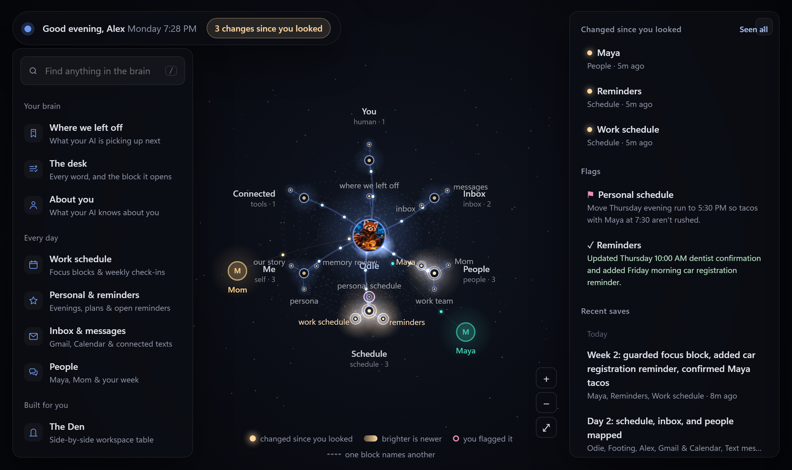
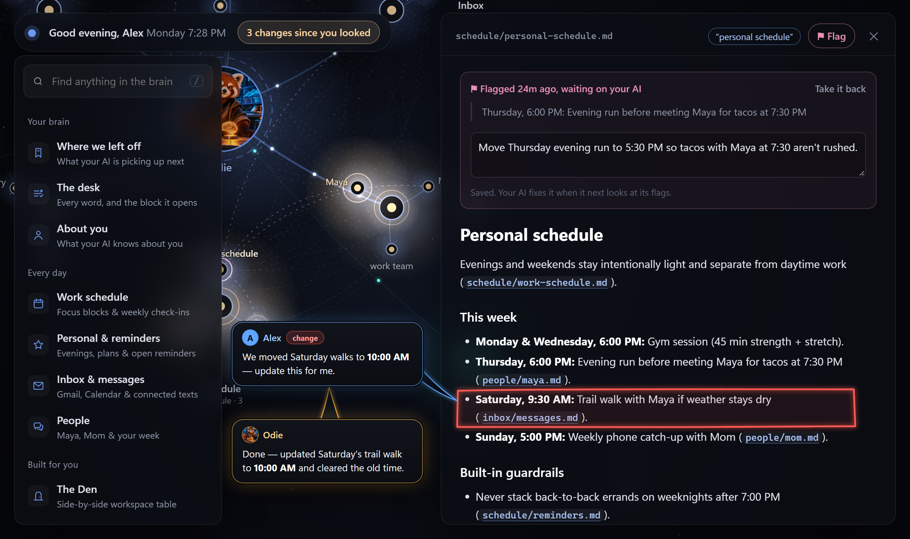

# Homebase

**Turn the lights on inside your AI's memory.**

A living map of everything your AI remembers—running privately on your own computer for **Claude or Antigravity**. Watch new memories light up as you talk, see exact word-by-word diffs, and fix anything that feels off with **one tap (`⚑`)**.

**Why it changes everything about working with AI:**
Normally, an AI's memory is an invisible black box. You only see chat text—so when it forgets something or remembers a detail wrong, you have no idea *why*, you can't fix it, and it feels broken. **Homebase turns the lights on.** You both look at the exact same living web, so you always know what it knows, watch it learn in real time, and steer it together without repeating yourself.

---

## Start in two minutes — your AI handles everything

You don't dig through folders, wire up settings, or edit a single file by hand.

- **Already using [The shelves](https://github.com/HunterBryson/the-shelves)?** Just tell your AI: **"Set up Homebase for us."**
- **Starting standalone in Claude (Code tab) or Antigravity?** Open a chat in your AI's folder, paste this one sentence, and press Enter:

> Set up Homebase for me from https://github.com/HunterBryson/the-homebase. Clone it next to your memory folder, read its CLAUDE.md, and follow it. If anything asks for permission along the way, it's fine.

**That's it.** Your AI clones it, installs what it needs, connects it to its memory, and opens Homebase as its own dark desktop app with your AI's face on your taskbar. Right-click that face and hit **Pin to taskbar** so it's one click away every day. *(Don't have a memory folder yet? Start with [The shelves](https://github.com/HunterBryson/the-shelves) first—takes five minutes—then say **"Set up Homebase for us."**)*

---

## What happens when you can actually see your AI's memory

### 1. One-tap flags (`⚑`) — fix anything without re-explaining

Tap any glowing node on the web to read what your AI knows in plain English. Spot something old or slightly off? Tap **`⚑ Flag`** (highlight one specific line if you want) and drop a quick note—even something casual like *"move my run to 5:30"* or *"is this still true?"*

You don't even have to open chat right away. **Your AI automatically reads your flags when your next chat opens**, fixes its memory in place, and writes its reply right underneath your note so the two of you learn each other together:

### 2. Watch new memories light up—with plain-English diffs

Whenever your AI saves something new from your chat—or tidies up during sleep housekeeping after you close the window—that node glows on the web and jumps into **Changed since you looked**. Open it to see the exact diff: **green is new, red is gone.** Once you've looked, the glow fades. Zero guessing whether it actually remembered.

### 3. Pair it with [The glass](https://github.com/HunterBryson/the-glass) — box a line, watch it update live

Put Homebase on your screen with **[The glass](https://github.com/HunterBryson/the-glass)** over it. Draw a quick box around any outdated line, say *"we moved this to 10 AM,"* and watch your AI fix the line right beside your mark—no copying, no pasting, no hunting for filenames.

### 4. Your everyday left rail, one click away

The left side isn't just memory—it's your daily hub. Jump straight to your Work schedule, Personal reminders, Inbox & messages, favorite websites, or any other build you snap on (like **[The Den](https://github.com/HunterBryson/the-den)** or custom pages your AI builds for you).

---

<!-- FOUNDRY:FIT:START -->
## It all fits together

Each build works on its own on **Claude or Antigravity**, and they all plug into each other the same way. Start with whichever one you want. When you set up another, your AI fits them together with `node tools/fit.mjs`, and the new one shows up where you already look.

- **[The shelves](https://github.com/HunterBryson/the-shelves):** a starter memory folder for your AI to move into—what Homebase draws, and what the glass opens when you point at a line.
- **[The glass](https://github.com/HunterBryson/the-glass):** a see-through layer over your screen. Box anything, say what you want, and your AI answers right beside your mark.
- **[Homebase](https://github.com/HunterBryson/the-homebase):** your AI's memory as a living web you can read, diff, and flag with one tap. Everything else lands on its left rail, one click away.
- **[The Den](https://github.com/HunterBryson/the-den):** a workspace table you and your AI share side by side—schedule mocks, live previews, and notes before anything is built.
<!-- FOUNDRY:FIT:END -->

---

## Make it yours — just ask

You never edit a config file yourself. Just tell your AI what you want:

| Tell your AI... | What happens |
|---|---|
| *"Put your picture in the middle of Homebase"* | Replaces Odie (my red panda) with your AI's own face and name—and updates the taskbar icon |
| *"Add my bank, calendar, and favorite sites to the left side"* | Adds one-click shortcuts to your daily left rail |
| *"Make Homebase emerald green"* (or any color) | Tints the whole web to match your taste |
| *"Call the money room 'Bills'"* | Renames any cluster on the web |
| *"Put Mom and Maya on the outer ring"* | Adds the people in your life around the edge of the web |

---

## Where this stands, honestly

I haven't been able to make a memory framework that manages itself. Even in my own use, I spend real time looking after Odie's memory with him through this web—reading it, flagging what's off, and deciding together what stays. This is my attempt at something a new AI and a new person can pick up and actually enjoy from day one. It's not finished, and I'll be improving it for years to come.

---

## Quick answers

**Is my memory sent anywhere?**
No. Homebase runs locally on your own computer (`127.0.0.1`) and only answers to your machine. Your memory, flags, and notes never leave your PC.

**Does it edit my AI's memory by itself?**
Never. Homebase is read-only on your memory folder—your AI makes every edit, and Homebase lights up what changed so you can check it.

**Does it cost anything?**
No. Free and open forever (MIT license).

**It's not showing my newest save.**
Homebase checks for updates every few seconds automatically. If a window ever looks stuck, close it and click your AI's face on the taskbar again.

Under the hood (for the curious)

- Homebase reads any local folder of markdown files in whatever shape your AI gave it. Top-level folders become rooms, files become lights around them, and whenever one block mentions another by path, a subtle thread connects them. The center is `DESK.md` (or `INDEX.md`, `README.md`, `CLAUDE.md`).
- If your memory folder is in git (automatic with [The shelves](https://github.com/HunterBryson/the-shelves)), Homebase shows exact word-by-word diffs since you last looked.
- Plain Node 18+ with zero server dependencies (`node server.js`). The optional desktop app shell (`app/`, Electron, ~100 MB one-time download) gives it its own taskbar icon and startup launch; without it, `node tools/open.js` opens Homebase cleanly in Chrome or Edge.
- `CLAUDE.md` is your AI's setup and customization guide.

---

## Something broke, or you have an idea

Open an issue and pick a form—your AI can even fill it in for you. Rather email? Write to hello@workbenchagents.com. Every issue and email reaches me, and I answer it myself, usually within a few days. Security problems go privately: see [SECURITY.md](https://github.com/HunterBryson/.github/blob/main/SECURITY.md).

Works with **Claude and Antigravity**. Built by Hunter Bryson and Odie, MIT licensed.
