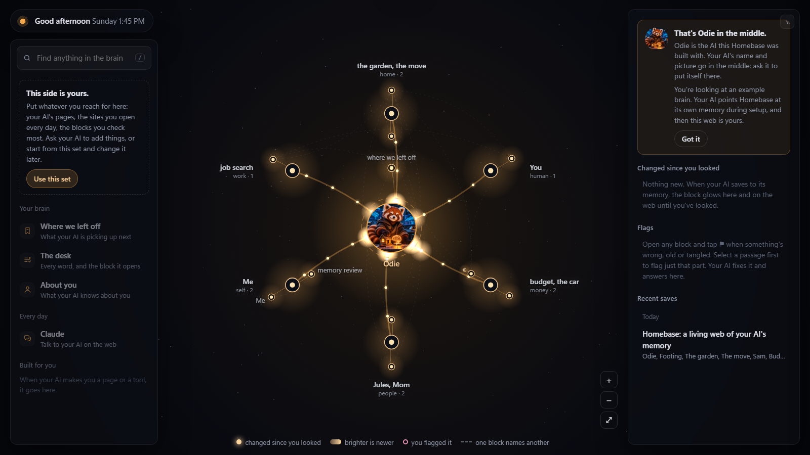
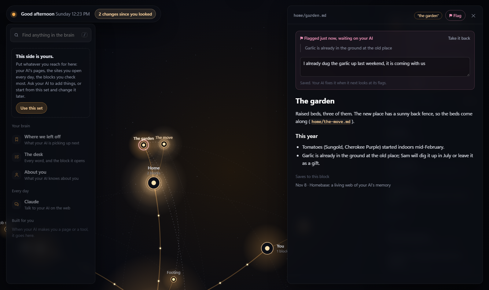
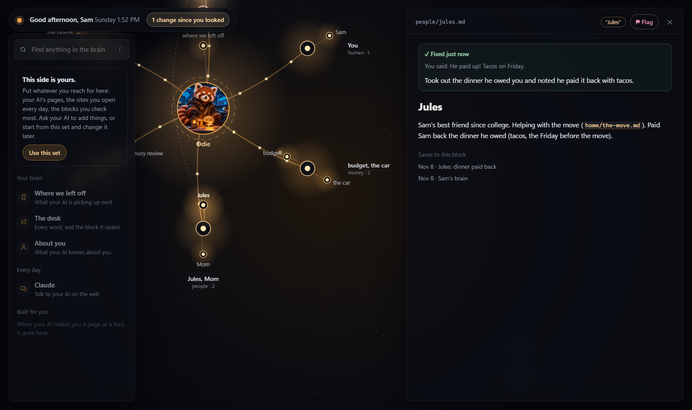
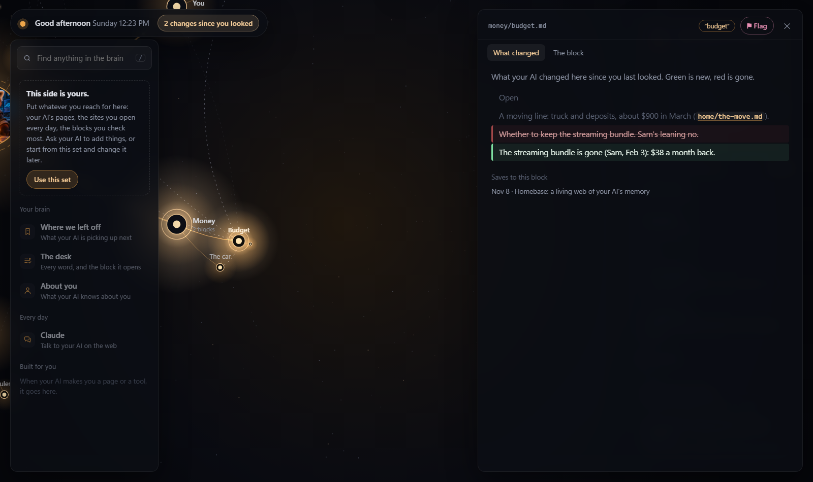

# Homebase

**See your AI's memory, fix what's wrong with one tap, and watch what it learns.**

If your AI keeps a memory in files, Homebase draws it as a living web on your own computer. The AI sits in the middle. Each light is one thing it remembers: your budget, your garden, the people in your life. Tap a light to read exactly what it knows. When something's wrong, flag it, and your AI fixes it next time you talk. When your AI learns something new, that light glows until you've looked.

## Why I made it

An AI's memory usually lives behind the scenes. When it remembers something wrong, or forgets something you told it, you can't see why. It just feels broken, and most people give up right there. I've felt that with every agent I've built.

Seeing the memory changes how you work with your AI:
- **You understand it.** You see what it knows about you, in its own words, so you know what to tell it and what it already has. You can point at the exact thing you mean ("this block, this line") instead of explaining it all over again.
- **You can ask it what's going on.** When something feels off, you don't have to guess. Point at the light and ask your AI about it: why it thinks that, where it came from, whether it's still true. It can explain its own memory to you, because you're both looking at the same thing.
- **You can keep it right.** When something's wrong or out of date, one tap tells your AI, and you watch it get fixed. A memory nobody can see slowly fills with old mistakes. A memory you can see stays clean, because the two of you look after it together.
- **You can trust it.** When your AI says "I saved that," you can watch the light come on and read what it wrote.

And it's even better with [the glass](https://github.com/HunterBryson/the-glass). Box a line of your AI's memory, say "this is old," and it fixes the line while you watch. Odie (the red panda in the middle, until your AI puts itself there) is my AI, and this is how we look after his memory together every day.

## Where this stands, honestly

I haven't been able to make a memory framework that manages itself. Even in my own use, I spend a lot of time looking after Odie's memory with him, through this web: reading it, flagging what's off, deciding together what stays. This is my attempt at something a new AI and a new person can pick up and use well from day one. It's not finished, and I'll be improving it for years to come.

## What you do with it

**Read it.** Tap any light, and the block opens on the right: what your AI knows, in its own words. If you say a block's word to your AI (like "budget"), that's the block it reads.

**Flag what's wrong.** Tap ⚑ on any block. If only one part is wrong, select that part first. Add a few words if you want ("the garlic is already dug up"). Your AI sees your flags when it starts, fixes the block, and its answer shows up right under your flag.

When your AI fixes it, its answer sits right under your words, and you can see exactly what it changed in the block:

**Not sure what to do?** Flag anything at all, even "this doesn't sound like me" or "is this still true?" Your AI looks at the block with you and works it out. Flags are the easiest way into your AI's memory: you don't have to know how it works to point at something.

**See what changed.** Whenever your AI saves something to its memory, that light glows on the web and shows up under "Changed since you looked." Open it to see what changed. If your AI's memory is kept in git (the shelves are), you'll see it word by word: new words in green, removed words crossed out. The glow fades once you've looked.

**Even better with [the glass](https://github.com/HunterBryson/the-glass).** The glass is a see-through layer over your screen, where you circle or box anything and send it to your AI with a few words, and it answers right beside your mark. Put Homebase on one side and the glass over it, and you can box a line of your AI's memory and say "this is old," and it fixes the line while you watch. Your AI can draw on the glass too, so it can point at the part of its memory it means instead of describing it. It's how Odie and I look after his memory every day, and it's the easiest start for someone new: you don't need to know what to ask, you just point.

**Make the left side yours.** It starts nearly empty. Fill it with whatever you reach for: pages your AI builds you, sites you open every day, the blocks you check most. Ask your AI to add things, or start from the suggested set.

## Setting it up

You need an AI that works on **your own computer** and keeps its memory in files there. (Claude on the web, on a phone, or in a cloud session can't: Homebase reads a folder on your machine.) The **Claude desktop app** with its **Code** tab works well; so does any AI that can run commands in a folder (Codex, Cursor and others).

Open a chat with your AI, in the folder where it lives, and paste this:

> Set up Homebase for me from https://github.com/HunterBryson/the-homebase. Clone it next to your memory folder, read its CLAUDE.md, and follow it. If anything asks for permission along the way, it's fine.

Your AI does the rest. If your computer doesn't have Node (the small program Homebase runs on), it'll install it, and your computer may ask you to allow that once. Then a window opens with your AI's memory in it, and a Homebase shortcut lands on your desktop. Your AI will show you around.

**Your AI doesn't keep memory in files yet?** Start with [the shelves](https://github.com/HunterBryson/the-shelves): a starter brain any Claude can move into with one pasted line. Then set up Homebase.

## Making it yours

You don't edit anything yourself. Just ask your AI.

| Ask your AI to... | What changes |
|---|---|
| "Put your picture in the middle of Homebase" | Its picture and name replace Odie's |
| "Add my bank and my calendar to the left side of Homebase" | Your links show up on the left |
| "Make Homebase blue" | The web's color |
| "Call the money room 'Bills'" | How a room is named on the web |
| "Put Mom and Dad at the edge of the web" | People or other AIs, on the outer ring |

## Questions people ask

**What's a "repo"?** A folder of files kept online, on GitHub. This one holds Homebase. You don't need to understand it or make an account: your AI copies the folder to your computer and sets it up.

**Is my memory sent anywhere?** No. Homebase runs only on your own computer, and it only answers to your computer. Your AI's memory never leaves your machine, and your flags and notes stay in Homebase's own `data` folder, which is never uploaded.

**Does it cost anything?** No. It's free and open (MIT license).

**Does it change my AI's memory?** Never on its own. It only reads. Your AI makes the changes, and Homebase shows you what changed.

**It's not showing the newest thing.** It checks for changes every few seconds by itself. If the window seems stuck, close it and open the shortcut again.

## For the curious

- Homebase reads any folder of markdown, in the shape your AI gave it. Folders become rooms (named by the words your AI uses for them), files become the blocks around them, and when one block mentions another by its path, a thread is drawn between them. The center is the AI's `DESK.md` (or `README.md`, `INDEX.md` or `CLAUDE.md`).
- A block that's been changed since you looked glows. If the memory folder is in git, Homebase can show exactly what changed.
- There's nothing to install beyond Node. `node server.js` runs it; `node tools/open.js` starts it and opens the window.
- `CLAUDE.md` is the AI's side: how to set it up, how flags reach it, how to make it yours.

Built with Claude, and it works best with Claude. Odie wrote the code, with me steering, testing and pushing every step of the way. MIT.
