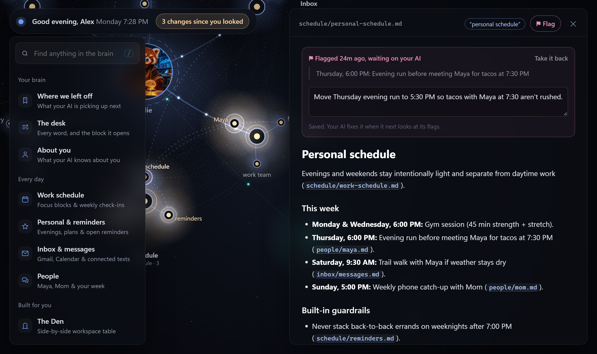
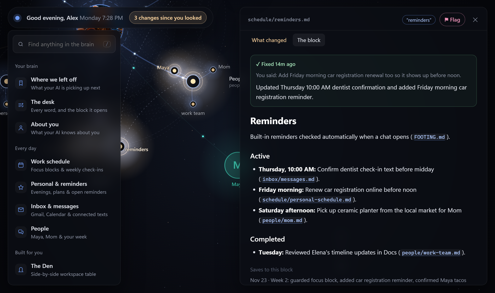
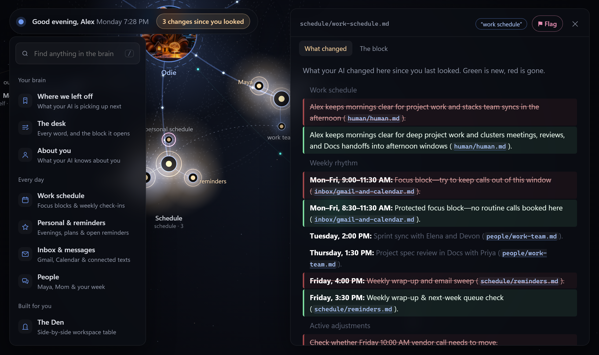

# Homebase

**Start with one real ask. Watch it become something special to you.** See your AI's memory as a living web, fix anything that's off with one tap, and watch what it learns across **Claude or Antigravity**.

If your AI keeps a memory in files, Homebase draws it as a living web on your own computer. Your AI sits in the middle. Each light is one thing it remembers: your Work schedule, your Personal reminders, what it learned after you connected your texts, and the people in your life. Tap a light to read exactly what it knows. When something's wrong, flag it in one tap, and your AI fixes it in place. When your AI saves something new—even during sleep housekeeping after you close chat—that light glows until you've looked.

## Why I made it

An AI's memory usually lives behind the scenes. When it remembers something wrong, or forgets something you told it, you can't see why. It just feels broken, and most people give up right there. I've felt that with every agent I've built.

Seeing the memory changes how you work with your AI:
- **You understand it.** You see what it knows about you, in its own words, so you know what to tell it and what it already has. You can point at the exact thing you mean ("this block, this line") instead of explaining it all over again.
- **You can ask it what's going on.** When something feels off, you don't have to guess. Point at the light and ask your AI about it: why it thinks that, where it came from, whether it's still true. It can explain its own memory to you, because you're both looking at the same thing.
- **You can keep it right.** When something's wrong or out of date, one tap tells your AI, and you watch it get fixed. A memory nobody can see slowly fills with old mistakes. A memory you can see stays clean, because the two of you look after it together.
- **You can trust it.** When your AI says "I saved that," you can watch the light come on and read what it wrote.

And it's even better with [the glass](https://github.com/HunterBryson/the-glass). Box a line of your AI's memory, say "this is old," and it fixes the line while you watch. Odie (the red panda in the middle, until your AI puts itself there) is my AI, and this is how we look after his memory together every day.

## Where this stands, honestly

I haven't been able to make a memory framework that manages itself. Even in my own use, I spend a lot of time looking after Odie's memory with him, through this web: reading it, flagging what's off, deciding together what stays. This is my attempt at something a new AI and a new person can pick up and use well from day one. It's not finished, and I'll be improving it for years to come.

## What you do with it

**Read it.** Tap any light, and the block opens on the right: what your AI knows, in its own words. If you say a block's word to your AI (like "budget"), that's the block it reads.

**Flag what's wrong.** Tap ⚑ on any block. If only one part is wrong, select that line first and add a quick note ("Friday mornings are deep work now, move calls to 1 PM"). Your AI sees your flags on open, updates its memory in place, and writes its reply right under your flag.

When your AI fixes it, its answer sits right under your words, and you can inspect the exact word-by-word diff:

**Not sure what to do?** Flag anything at all, even "this doesn't sound right" or "is this still true?" Your AI looks at the block with you and fixes it in one conversation. Flags are the easiest way into your AI's memory: you don't have to know how it works to point at something.

**See what changed.** Whenever your AI updates a schedule, picks up a new reminder from an email or text, or runs sleep housekeeping, that light glows on the web and shows up under "Changed since you looked." Open it to see the exact diff: new words in green, removed words crossed out. The glow fades once you've looked.

**Even better with [the glass](https://github.com/HunterBryson/the-glass).** The glass is a see-through layer over your screen, where you circle or box anything and send it to your AI with a few words, and it answers right beside your mark. Put Homebase on one side and the glass over it, and you can box a line of your AI's memory and say "this is old," and it fixes the line while you watch. Your AI can draw on the glass too, so it can point at the part of its memory it means instead of describing it.

**The left rail works out of the box.** Jump straight to your Work schedule, Personal reminders, Inbox & messages, or any plugged-in tool like The Den—and ask your AI to add whatever else you reach for every day.

<!-- FOUNDRY:FIT:START -->
## It all fits together

Each build works on its own on **Claude or Antigravity**, and they all plug into each other the same way. Start with whichever one you want. When you set up another, your AI fits them together with `node tools/fit.mjs`, and the new one shows up where you already look.

- **[The shelves](https://github.com/HunterBryson/the-shelves):** a starter memory folder for your AI to move into—what Homebase draws, and what the glass opens when you point at a line.
- **[The glass](https://github.com/HunterBryson/the-glass):** a see-through layer over your screen. Box anything, say what you want, and your AI answers right beside your mark.
- **[Homebase](https://github.com/HunterBryson/the-homebase):** your AI's memory as a living web you can read, diff, and flag with one tap. Everything else lands on its left rail, one click away.
- **[The Den](https://github.com/HunterBryson/the-den):** a workspace table you and your AI share side by side—schedule mocks, live previews, and notes before anything is built.
<!-- FOUNDRY:FIT:END -->

## Setting it up

You need an AI that works on **your own computer** and keeps its memory in files there. **Claude** (Desktop Code tab or CLI) and **Antigravity** both work out of the box—or any AI that can run local commands in a folder. (Hosted web-only chats can't read a folder on your machine.)

Open a chat with your AI, in the folder where it lives, and paste this:

> Set up Homebase for me from https://github.com/HunterBryson/the-homebase. Clone it next to your memory folder, read its CLAUDE.md, and follow it. If anything asks for permission along the way, it's fine.

Your AI does the rest. If your computer doesn't have Node (the small program Homebase runs on), it'll install it, and your computer may ask you to allow that once. Then Homebase opens as its own app, with your AI's face on the taskbar. Right-click that face and choose **Pin to taskbar**, and it's one click away for good. It also opens by itself when your computer starts (tell your AI if you'd rather it didn't). Your AI will show you around.

**Your AI doesn't keep memory in files yet?** Start with [the shelves](https://github.com/HunterBryson/the-shelves): a starter brain for **Claude or Antigravity** from one pasted line. Then set up Homebase.

## Making it yours

You don't edit anything yourself. Just ask your AI.

| Ask your AI to... | What changes |
|---|---|
| "Put your picture in the middle of Homebase" | Its picture and name replace Odie's |
| "Add my bank and my calendar to the left side of Homebase" | Your links show up on the left |
| "Make Homebase blue" | The web's color |
| "Call the money room 'Bills'" | How a room is named on the web |
| "Put Mom and Dad at the edge of the web" | People or other AIs, on the outer ring |

## Questions people ask

**What's a "repo"?** A folder of files kept online, on GitHub. This one holds Homebase. You don't need to understand it or make an account: your AI copies the folder to your computer and sets it up.

**Is my memory sent anywhere?** No. Homebase runs only on your own computer, and it only answers to your computer. Your AI's memory never leaves your machine, and your flags and notes stay in Homebase's own `data` folder, which is never uploaded.

**Does it cost anything?** No. It's free and open (MIT license).

**Does it change my AI's memory?** Never on its own. It only reads. Your AI makes the changes, and Homebase shows you what changed.

**It's not showing the newest thing.** It checks for changes every few seconds by itself. If the window seems stuck, close it and click its face on the taskbar again.

## For the curious

- Homebase reads any folder of markdown, in the shape your AI gave it. Folders become rooms (named by the words your AI uses for them), files become the blocks around them, and when one block mentions another by its path, a thread is drawn between them. The center is the AI's `DESK.md` (or `README.md`, `INDEX.md` or `CLAUDE.md`).
- A block that's been changed since you looked glows. If the memory folder is in git, Homebase can show exactly what changed.
- Homebase itself is plain Node with nothing to install: `node server.js` runs it. The app is a small window around it (`app/`, Electron, a one-time download of about 100 MB, about 280 MB on disk) so it can have its own taskbar button and start with the computer. Without it, `node tools/open.js` opens Homebase in a Chrome or Edge window instead.
- `CLAUDE.md` is the AI's side: how to set it up, how flags reach it, how to make it yours.

Works with **Claude and Antigravity**. Built by Hunter Bryson and Odie, MIT licensed.
